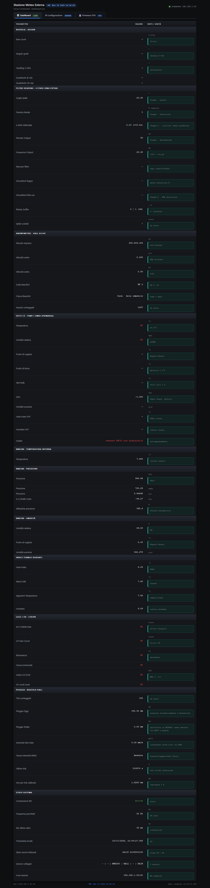
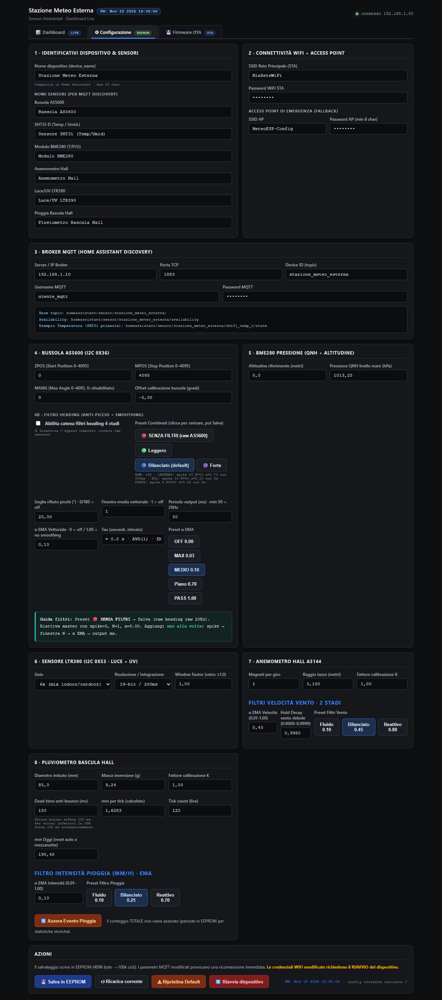
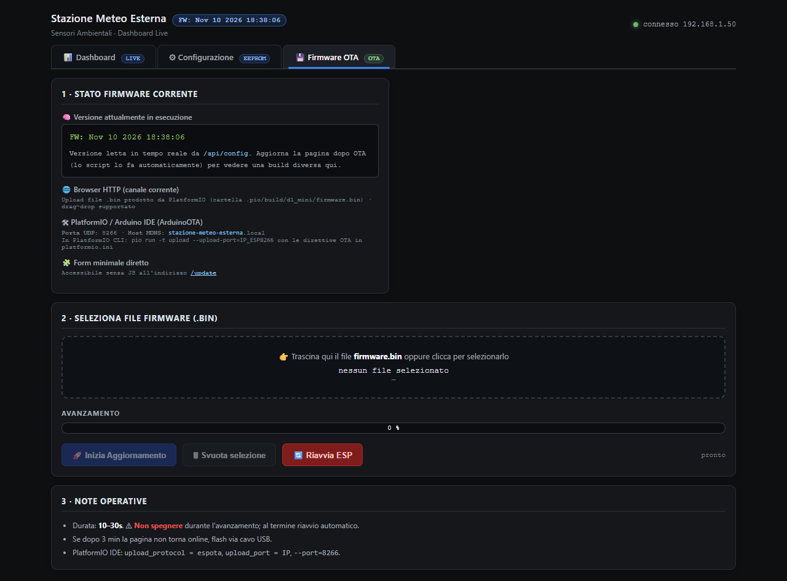

# 🌦️ Stazione Meteo ESP8266 (Wemos D1 Mini)

Firmware per una **stazione meteo fai-da-te** basata sulla scheda **Wemos D1 Mini (ESP8266)**.
Misura vento (velocità e direzione), temperatura, umidità, pressione, luce/UV e pioggia, e mostra tutto:

- su una **pagina web** interna al dispositivo (si apre dal browser di PC o smartphone);
- su **Home Assistant**, che riconosce i sensori **da solo** tramite MQTT (nessuna configurazione manuale delle entità);
- sulla **porta seriale** USB, per il debug.

Il firmware si aggiorna anche **via Wi-Fi (OTA)**: dopo la prima programmazione via cavo non serve più collegarlo al PC.



---

## 📑 Indice

1. [Cosa misura](#-cosa-misura)
2. [Materiale necessario](#-materiale-necessario)
3. [Collegamenti elettrici](#-collegamenti-elettrici)
4. [Installare il software sul PC](#-installare-il-software-sul-pc)
5. [Prima programmazione (via cavo USB)](#-prima-programmazione-via-cavo-usb)
6. [Primo avvio e configurazione Wi-Fi](#-primo-avvio-e-configurazione-wi-fi)
7. [La pagina web del dispositivo](#-la-pagina-web-del-dispositivo)
8. [Integrazione con Home Assistant](#-integrazione-con-home-assistant)
9. [Aggiornare il firmware via Wi-Fi (OTA)](#-aggiornare-il-firmware-via-wi-fi-ota)
10. [Calibrazione](#-calibrazione)
11. [Interfacce per utenti esperti (API, WebSocket, seriale)](#-interfacce-per-utenti-esperti)
12. [Risoluzione dei problemi](#-risoluzione-dei-problemi)
13. [Sicurezza](#-sicurezza)
14. [Struttura della repository](#-struttura-della-repository)
15. [Licenza](#-licenza)

---

## 📏 Cosa misura

| Grandezza | Sensore | Note |
|---|---|---|
| Direzione del vento (0–360°, rosa dei venti a 8 e 16 settori) | **AS5600** (encoder magnetico, I²C `0x36`) | Filtro anti-picchi a 4 stadi configurabile dalla pagina web |
| Velocità del vento (m/s, km/h, scala Beaufort), raffica massima 10 min | Sensore Hall **A3144** + magnete sull'anemometro | Raggio coppette e fattore di calibrazione configurabili |
| Temperatura e umidità (principale) | **SHT31-D** (I²C `0x44`) | Riscaldatore anti-condensa automatico (si accende sopra il 98% di umidità) |
| Pressione atmosferica, temperatura e umidità del modulo | **BME280** (I²C `0x76` o `0x77`) | Pressione riportata al livello del mare impostando l'altitudine |
| Luce (lux), indice UV | **LTR390** (I²C `0x53`) | Guadagno e risoluzione configurabili |
| Pioggia (mm oggi, mm totali, intensità mm/h, classe WMO) | Pluviometro a **bascula** con sensore Hall | Il totale viene salvato in memoria e sopravvive ai riavvii |

Grandezze **calcolate** dal firmware: punto di rugiada, punto di brina, temperatura di bulbo umido, VPD, umidità assoluta, heat index, humidex, wind chill, temperatura percepita.

> ℹ️ **Ogni sensore è facoltativo.** Se un sensore non è collegato, il firmware continua a funzionare e mostra `NC` (non collegato) al posto del valore. Nello screenshot qui sopra, ad esempio, SHT31, AS5600 e LTR390 erano scollegati.

---

## 🧰 Materiale necessario

| Quantità | Componente |
|---|---|
| 1 | **Wemos D1 Mini** (ESP8266) — o un clone compatibile |
| 1 | Modulo **AS5600** + magnete diametrale (di solito incluso col modulo) — per la banderuola |
| 1 | Sensore Hall **A3144** + piccolo magnete — per l'anemometro |
| 1 | Modulo **SHT31-D** |
| 1 | Modulo **BME280** (attenzione: non BMP280, che non misura l'umidità) |
| 1 | Modulo **LTR390** |
| 1 | Pluviometro a bascula con sensore Hall (o reed) |
| 2 | Resistenze da 4,7 kΩ (pull-up I²C, se i moduli non le hanno già) |
| 1 | Resistenza da 10 kΩ per ciascun sensore Hall (pull-up), se il modulo non la integra |
| 1 | Alimentatore USB 5 V / 1 A e cavo micro-USB **dati** (non solo ricarica) |
| — | Contenitore stagno e schermo solare per i sensori di temperatura/umidità |

---

## 🔌 Collegamenti elettrici

Tutti i sensori digitali (AS5600, SHT31, BME280, LTR390) condividono **lo stesso bus I²C**: si collegano in parallelo sugli stessi due fili.

```
                   Wemos D1 Mini
                 ┌───────────────┐
   3V3  ─────────┤ 3V3           │
   GND  ─────────┤ G             │
   SDA  ─────────┤ D2  (GPIO4)   │   ← SDA di AS5600, SHT31, BME280, LTR390
   SCL  ─────────┤ D1  (GPIO5)   │   ← SCL di AS5600, SHT31, BME280, LTR390
   Anemometro ───┤ D5  (GPIO14)  │   ← uscita del sensore Hall A3144
   Pluviometro ──┤ D7  (GPIO13)  │   ← uscita del sensore della bascula
                 └───────────────┘
```

| Sensore | Pin sensore | Pin D1 Mini |
|---|---|---|
| AS5600 / SHT31 / BME280 / LTR390 | VCC (o VIN) | **3V3** |
| | GND | **G** |
| | SDA | **D2** |
| | SCL | **D1** |
| A3144 (anemometro) | VCC / GND / OUT | 3V3 / G / **D5** |
| Pluviometro (Hall) | VCC / GND / OUT | 3V3 / G / **D7** |

⚠️ **Attenzione:**
- Alimenta i sensori a **3,3 V**, non a 5 V: l'ESP8266 non tollera 5 V sui pin.
- Il bus I²C funziona a **50 kHz** (valore scelto dopo aver visto errori di lettura del BME280 a 100 kHz su cavi lunghi). Se i fili verso i sensori sono lunghi, usa cavo schermato o twistato.
- Le uscite dei sensori Hall sono "open collector": serve una resistenza di pull-up verso 3,3 V (molti moduli già pronti la includono).

---

## 💻 Installare il software sul PC

Il progetto usa **PlatformIO**, un'estensione gratuita di Visual Studio Code che scarica da sola compilatore e librerie.

1. Installa **[Visual Studio Code](https://code.visualstudio.com/)**.
2. Apri VS Code → icona *Estensioni* (i quattro quadratini a sinistra) → cerca **PlatformIO IDE** → *Installa*. Attendi il termine dell'installazione e riavvia VS Code.
3. Scarica questa repository: pulsante verde **Code → Download ZIP** in alto in questa pagina, poi estrai lo ZIP. (Oppure, se usi git: `git clone https://github.com/PaoloPrandoniTechnology/stazione-meteo-esp8266.git`)
4. In VS Code: **File → Apri cartella…** e seleziona la cartella estratta (quella che contiene `platformio.ini`).

Le librerie necessarie vengono scaricate automaticamente alla prima compilazione:

| Libreria | Versione | Uso |
|---|---|---|
| `links2004/WebSockets` | 2.4.1 | Dati in tempo reale verso la pagina web |
| `adafruit/Adafruit BME280 Library` | 2.2.4 | Sensore BME280 |
| `adafruit/Adafruit Unified Sensor` | 1.1.14 | Dipendenza della libreria BME280 |
| `knolleary/PubSubClient` | 2.8 | Client MQTT per Home Assistant |

AS5600, SHT31 e LTR390 sono gestiti direttamente dal firmware, senza librerie esterne.

---

## 🔧 Prima programmazione (via cavo USB)

### 1. (Facoltativo) Inserisci i tuoi dati nel codice

Puoi inserire le credenziali anche dopo, dalla pagina web (vedi il capitolo successivo). Se però preferisci che il dispositivo si colleghi subito alla tua rete, apri `src/main.cpp`, cerca le righe `#define DEFAULT_…` (circa riga 470) e sostituisci i segnaposto:

```cpp
#define DEFAULT_WIFI_SSID      "IL_TUO_SSID"           // nome della tua rete Wi-Fi (2,4 GHz)
#define DEFAULT_WIFI_PASSWORD  "LA_TUA_PASSWORD_WIFI"  // password della rete
#define DEFAULT_AP_SSID        "MeteoESP-Config"       // nome della rete di emergenza creata dalla stazione
#define DEFAULT_AP_PASSWORD    "cambiami123"           // password della rete di emergenza (min. 8 caratteri)
#define DEFAULT_MQTT_SERVER    "192.168.1.10"          // indirizzo IP del broker MQTT (es. Home Assistant)
#define DEFAULT_MQTT_USER      "utente_mqtt"
#define DEFAULT_MQTT_PASSWORD  "password_mqtt"
```

> ⚠️ L'ESP8266 si collega **solo a reti a 2,4 GHz**, non a 5 GHz.

> 🔒 Se modifichi questi valori, **non ripubblicare** il file con le tue password (ad esempio su GitHub).

### 2. Compila e carica

1. Collega il D1 Mini al PC con il cavo USB.
2. Nella barra blu in basso di VS Code (PlatformIO) clicca la **freccia →** (*Upload*). La prima volta ci vorranno alcuni minuti per scaricare tutto.
3. Al termine compare `SUCCESS`. Il firmware compilato viene anche copiato nella cartella `firmware_output/` (con data e ora nel nome), utile per gli aggiornamenti via Wi-Fi.

Se l'upload non trova la scheda, vedi [Risoluzione dei problemi](#-risoluzione-dei-problemi).

### 3. Controlla che parta

Clicca l'icona a **spina** 🔌 nella barra blu (*Serial Monitor*, 115200 baud): vedrai i messaggi di avvio, il risultato della ricerca dei sensori e, se il Wi-Fi è corretto, l'indirizzo IP assegnato alla stazione.

---

## 📶 Primo avvio e configurazione Wi-Fi

All'accensione la stazione prova a collegarsi alla rete Wi-Fi salvata (11 tentativi, circa 3 minuti).

- **Se si collega:** l'indirizzo IP si legge sul monitor seriale o nella lista dei dispositivi del tuo router. Apri `http://<indirizzo-ip>/` dal browser.
  In alternativa, su molti PC e telefoni funziona anche `http://stazione-meteo-esterna.local/` (il nome deriva dal *Nome dispositivo* impostato).
- **Se non si collega:** la stazione crea una **rete Wi-Fi di emergenza** chiamata `MeteoESP-Config` (password `cambiami123`, se non l'hai cambiata). Collegati con il telefono a questa rete e apri **`http://192.168.4.1/`**. Nella scheda *Configurazione* inserisci la tua rete, premi **Salva in EEPROM** e poi **Riavvia dispositivo**.
  Anche in questa modalità la stazione continua a riprovare la rete principale ogni 30 secondi.

Le impostazioni salvate dalla pagina web restano in memoria anche togliendo l'alimentazione e hanno la precedenza sui valori scritti nel codice.

---

## 🖥️ La pagina web del dispositivo

La pagina ha tre schede.

### 📊 Dashboard (LIVE)

Mostra tutti i valori in tempo reale (aggiornati 20 volte al secondo tramite WebSocket), raggruppati per sensore, con unità di misura e una breve nota per ogni grandezza. In fondo c'è lo **stato del sistema**: connessione, frequenza dei pacchetti e quali sensori risultano collegati.

In alto a destra un pallino verde indica che la pagina riceve dati; se diventa rosso, la pagina si riconnette da sola.

### ⚙️ Configurazione (EEPROM)



| Sezione | Cosa si imposta |
|---|---|
| 1 · Identificativi | Nome del dispositivo e nome di ciascun sensore (come appariranno in Home Assistant) |
| 2 · Wi-Fi + Access Point | Rete di casa e rete di emergenza |
| 3 · Broker MQTT | Indirizzo, porta, utente, password e *Device ID* (usato nei topic MQTT). Sotto viene mostrata un'anteprima dei topic |
| 4 · Bussola AS5600 | Zero meccanico, offset in gradi e filtro anti-picchi (con preset *Senza filtri / Leggero / Bilanciato / Forte*) |
| 5 · BME280 | Altitudine della stazione per calcolare la pressione al livello del mare |
| 6 · LTR390 | Guadagno, risoluzione e fattore di correzione per il vetro di protezione |
| 7 · Anemometro | Numero di magneti per giro, raggio delle coppette, fattore di calibrazione e filtri |
| 8 · Pluviometro | Diametro dell'imbuto, massa di ribaltamento della bascula, calibrazione, filtro e **azzeramento** del totale |

Pulsanti in fondo alla pagina:
- **Salva in EEPROM** — memorizza le impostazioni (le modifiche MQTT si applicano subito; quelle Wi-Fi dopo il riavvio).
- **Ricarica corrente** — annulla le modifiche non salvate.
- **Ripristina Default** — torna ai valori scritti nel codice.
- **Riavvia dispositivo**.

### 💾 Firmware OTA



Permette di caricare un nuovo firmware trascinando il file `.bin`. Vedi [Aggiornare il firmware via Wi-Fi](#-aggiornare-il-firmware-via-wi-fi-ota).

---

## 🏠 Integrazione con Home Assistant

La stazione usa **MQTT Discovery**: appena si collega al broker, Home Assistant crea automaticamente un dispositivo con circa 40 entità (vento, temperature, pressione, pioggia, UV, diagnostica Wi-Fi, RAM, uptime…).

### Requisiti

1. Un broker MQTT. Il modo più semplice è l'add-on **Mosquitto broker** di Home Assistant (*Impostazioni → Componenti aggiuntivi → Raccolta → Mosquitto broker → Installa → Avvia*).
2. L'integrazione **MQTT** attiva in Home Assistant (*Impostazioni → Dispositivi e servizi*; di solito viene proposta automaticamente dopo l'installazione di Mosquitto).
3. Un utente per il broker: crealo in *Impostazioni → Persone → Utenti* (ad esempio `utente_mqtt`) e usa le stesse credenziali nella sezione **3 · Broker MQTT** della pagina di configurazione della stazione.

Dopo il salvataggio, il dispositivo compare in *Impostazioni → Dispositivi e servizi → MQTT* con il nome scelto (default *Stazione Meteo Esterna*).

### Topic MQTT

```
homeassistant/sensor/<device_id>/availability          → "online" / "offline"
homeassistant/sensor/<device_id>/<sensore>/state       → valore
homeassistant/sensor/<device_id>/<sensore>/config      → configurazione Discovery (JSON)
```

Il `<device_id>` predefinito è `stazione_meteo_esterna`. I dati del vento sono inviati 4 volte al secondo, gli altri ogni 5–10 secondi e solo quando cambiano.

### Dashboard pronta all'uso

Nel file [`docs/dashboard-home-assistant.yaml`](docs/dashboard-home-assistant.yaml) trovi una dashboard completa. Richiede queste card personalizzate, installabili da **[HACS](https://hacs.xyz/)** (*HACS → Frontend → cerca il nome → Scarica*):

- `bar-card`
- `mini-graph-card`
- `Mushroom`
- `windrose-card`
- `card-mod`

Per usarla: *Impostazioni → Dashboard → Aggiungi dashboard → Nuova dashboard da zero*, aprila, *⋮ → Modifica dashboard → ⋮ → Editor di configurazione testuale*, incolla il contenuto del file e salva.

> Se hai cambiato il *Device ID* o i nomi, gli ID delle entità saranno diversi: adatta il file (cerca e sostituisci `stazione_meteo_esterna`).

---

## 🔄 Aggiornare il firmware via Wi-Fi (OTA)

Dopo la prima programmazione via USB ci sono tre modi per aggiornare il firmware senza cavo:

1. **Dalla pagina web** (il più semplice): compila in PlatformIO con il pulsante ✓ (*Build*), poi nella scheda **Firmware OTA** trascina il file `.pio/build/d1_mini/firmware.bin` (oppure `firmware_output/firmware_latest.bin`) e premi **Inizia Aggiornamento**. Dura 10–30 secondi, poi la stazione si riavvia da sola. **Non togliere l'alimentazione** durante l'operazione.
2. **Form minimale** all'indirizzo `http://<indirizzo-ip>/update` (funziona anche senza JavaScript).
3. **Da PlatformIO** con ArduinoOTA (porta 8266): aggiungi in fondo a `platformio.ini`
   ```ini
   upload_protocol = espota
   upload_port     = 192.168.1.50   ; indirizzo IP della tua stazione
   ```
   e premi *Upload* come di consueto.

Se dopo 3 minuti la stazione non torna online, riprogrammala via cavo USB.

---

## 🎯 Calibrazione

**Direzione del vento (AS5600):** orienta la banderuola esattamente verso **Nord**, leggi l'*Angolo gradi* nella dashboard e inserisci il valore con il segno opposto in *Offset calibrazione bussola* (sezione 4). Esempio: se leggi 12°, imposta −12.

**Velocità del vento:** imposta il raggio delle coppette (distanza tra l'asse di rotazione e il centro di una coppetta, in metri) e il numero di magneti. Se hai un anemometro di riferimento, regola il *Fattore calibrazione K* finché le due letture coincidono.

**Pluviometro:** imposta il diametro dell'imbuto e la massa d'acqua che fa ribaltare la bascula. La pagina calcola i *mm per tick*. Per verificare: versa lentamente una quantità nota d'acqua (ad esempio 100 ml) e confronta i millimetri misurati con quelli attesi (ml ÷ area dell'imbuto in cm² × 10); correggi con il *Fattore calibrazione K*.

**Pressione (BME280):** inserisci l'altitudine della stazione in metri per ottenere la pressione riportata al livello del mare, confrontabile con i bollettini meteo.

---

## 🧑‍💻 Interfacce per utenti esperti

### Endpoint HTTP (porta 80)

| Metodo | Percorso | Descrizione |
|---|---|---|
| GET | `/` | Pagina web completa |
| GET | `/api/config` | Configurazione corrente (JSON) |
| POST | `/api/config` | Salva la configurazione (JSON) |
| GET | `/api/labels` | Nomi del dispositivo e dei sensori |
| POST | `/api/rain/reset` | Azzera il totale della pioggia |
| POST | `/api/restart` | Riavvia la stazione |
| GET | `/api/i2cdiag`, `/api/i2ctest` | Diagnostica del bus I²C |
| GET / POST | `/update` | Aggiornamento firmware OTA |

### WebSocket (porta 81)

`ws://<indirizzo-ip>:81/` invia i dati 20 volte al secondo in formato **binario** (array di `float32` little-endian). L'ordine dei campi è definito in `src/main.cpp` dentro `loop()` (cerca `broadcastBIN`) e decodificato dalla pagina web.

### Monitor seriale

115200 baud. All'avvio stampa un rapporto diagnostico (motivo dell'ultimo riavvio, eventuale crash precedente, memoria libera, sensori trovati); poi messaggi di stato di Wi-Fi, MQTT e sensori.

### Robustezza

- **Watchdog hardware** e un **supervisore MQTT a 4 livelli**: se la connessione si blocca, la stazione prova prima a riconnettere MQTT, poi a riavviare il Wi-Fi e, dopo 2 minuti senza successo, si riavvia da sola.
- **Crash logger** nella memoria RTC: dopo un crash, il riavvio successivo stampa il contesto dell'errore.
- **Configurazione con CRC** e migrazione automatica dalle versioni precedenti: una memoria corrotta non blocca la stazione, che torna ai valori predefiniti.

---

## 🩺 Risoluzione dei problemi

| Problema | Cosa fare |
|---|---|
| PlatformIO non trova la porta USB | Usa un cavo **dati** (molti cavi sono solo di ricarica) e installa il driver **CH340** del D1 Mini. |
| Upload interrotto o lento | In `platformio.ini` abbassa `upload_speed` da `921600` a `115200`. |
| Non si collega al Wi-Fi | Verifica che la rete sia a **2,4 GHz** e la password corretta; collegati alla rete di emergenza `MeteoESP-Config` → `http://192.168.4.1/`. |
| Un sensore mostra `NC` | Controlla alimentazione 3,3 V, SDA/SCL non invertiti e i pull-up. L'endpoint `/api/i2cdiag` mostra quali indirizzi rispondono sul bus. |
| La dashboard non si aggiorna (pallino rosso) | Il browser deve raggiungere anche la **porta 81**; alcune reti "ospiti" o VPN la bloccano. |
| Home Assistant non mostra il dispositivo | Controlla indirizzo, utente e password del broker; nel monitor seriale cerca i messaggi `MQTT`. |
| La direzione del vento "salta" | Il magnete dell'AS5600 deve essere centrato e a 1–3 mm dal chip; prova il preset filtro *Bilanciato* o *Forte*. |

---

## 🔒 Sicurezza

- La pagina web e l'aggiornamento OTA **non hanno password**: chiunque sia collegato alla stessa rete può modificare la configurazione o caricare un firmware. Usa la stazione solo su una rete domestica fidata e **non esporla su Internet** (niente port forwarding sul router).
- Le password Wi-Fi e MQTT sono salvate in chiaro nella memoria del dispositivo e sono leggibili da `/api/config`.
- Cambia la password della rete di emergenza (`DEFAULT_AP_PASSWORD`) prima di installare la stazione all'aperto.

---

## 📂 Struttura della repository

```
├── src/
│   └── main.cpp                         firmware completo (unico file sorgente)
├── platformio.ini                       configurazione della scheda e delle librerie
├── extra_script.py                      copia il .bin compilato in firmware_output/ con data e ora
├── docs/
│   ├── dashboard-home-assistant.yaml    dashboard pronta per Home Assistant
│   └── screenshots/                     immagini usate in questo README
├── LICENSE
└── README.md
```

---

## 📜 Licenza

Distribuito con licenza **MIT**: puoi usarlo, modificarlo e ridistribuirlo liberamente, anche per scopi commerciali, mantenendo l'avviso di copyright. Vedi [LICENSE](LICENSE).
